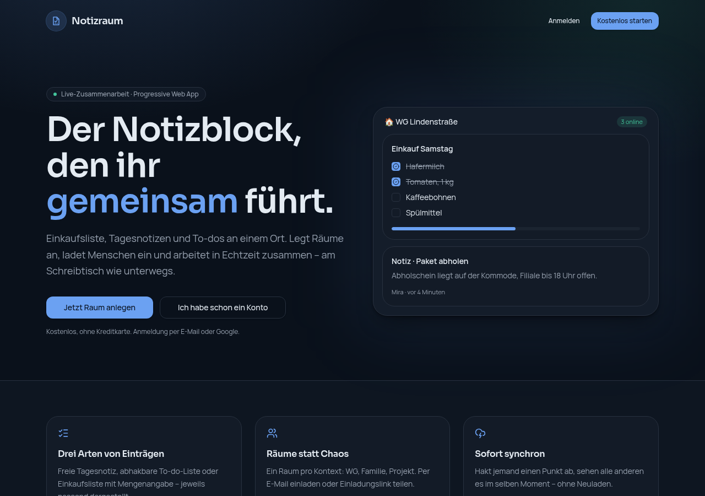
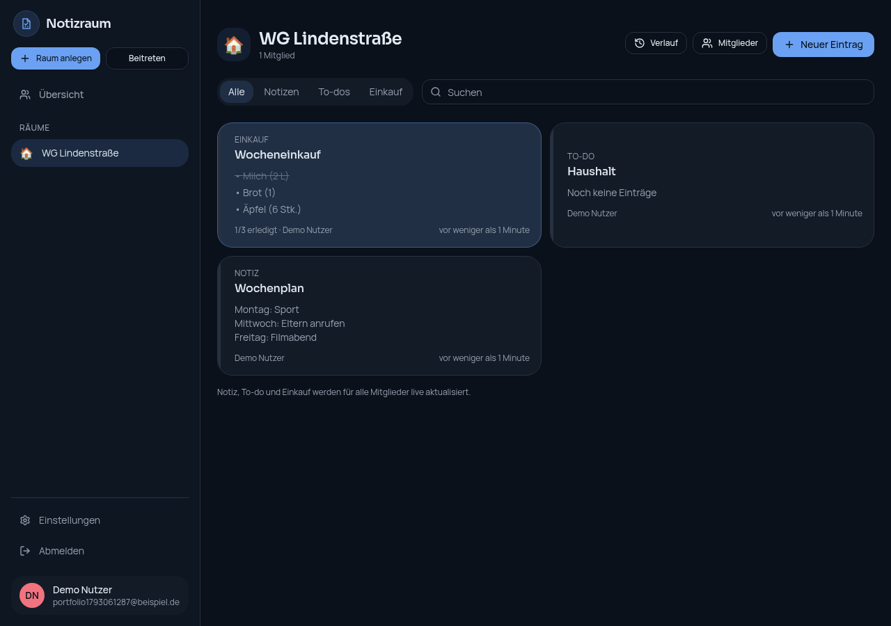
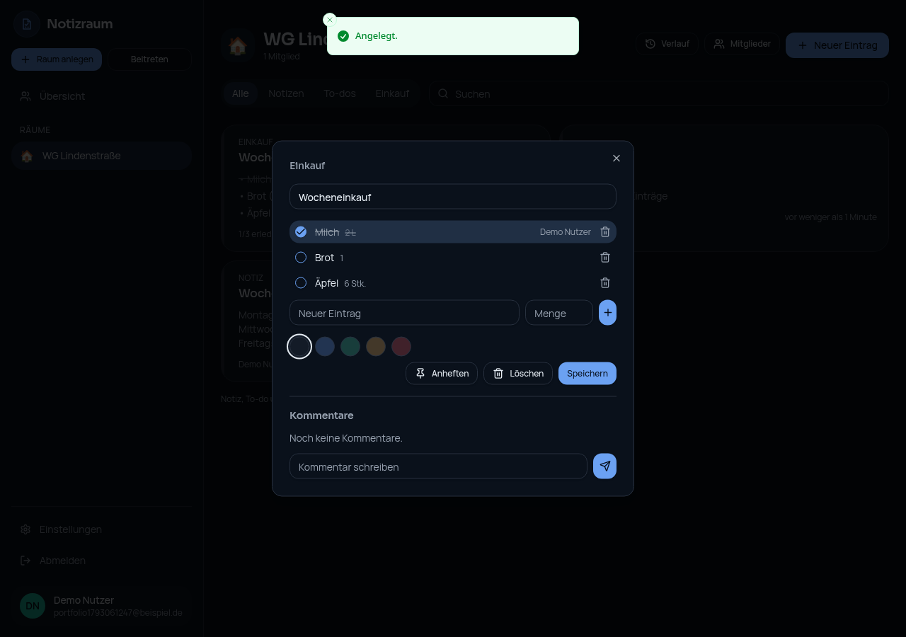
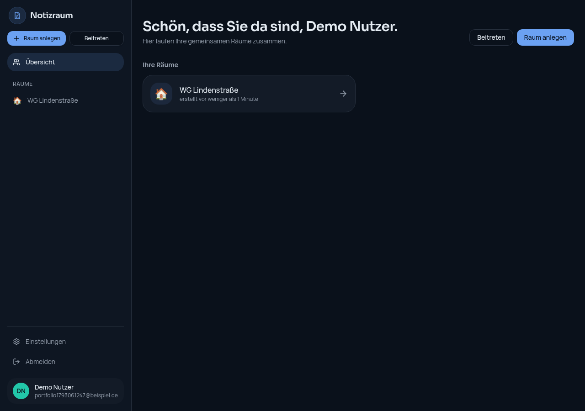
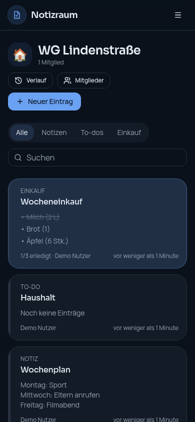

# Notizraum

**Der Notizblock, den ihr gemeinsam führt.** Notizraum ist eine Progressive Web App (PWA), mit der mehrere Personen in gemeinsamen Räumen Notizen, To-do-Listen und Einkaufslisten in Echtzeit teilen – am Schreibtisch wie unterwegs.

Gebaut mit Hilfe generativer KI ([Lovable](https://lovable.dev)) als Portfolio-Projekt.

## Funktionen

- **Gemeinsame Räume** – ein Raum pro Kontext (WG, Familie, Projekt), Einladung per E-Mail oder Einladungscode
- **Drei Arten von Einträgen** – freie Notizen, abhakbare To-dos und Einkaufslisten mit Mengenangabe
- **Echtzeit-Synchronisation** – Änderungen erscheinen sofort bei allen Mitgliedern, ohne Neuladen
- **Kommentare & Verlauf** – Diskussion pro Eintrag und chronologischer Aktivitätsverlauf pro Raum
- **Suche & Filter** – nach Eintragsart filtern, Titel und Inhalte durchsuchen, Einträge anheften
- **PWA** – installierbar auf Android, iOS und Desktop, eigenes App-Icon, Standalone-Darstellung
- **Authentifizierung** – E-Mail/Passwort und Google-Login, Profile mit Anzeigename und Avatar-Farbe
- **Responsive Design** – mobile-first mit eigener Drawer-Navigation, Desktop mit Sidebar

## Tech-Stack

| Bereich | Technologie |
| --- | --- |
| Frontend | React 19, TypeScript, Vite 7 |
| Framework | TanStack Start (SSR) + TanStack Router |
| Styling | Tailwind CSS v4, shadcn/ui, eigene Design-Tokens |
| State / Daten | TanStack Query |
| Backend | Lovable Cloud (Supabase): PostgreSQL, Auth, Realtime |
| Sicherheit | Row Level Security (RLS), RPC-Funktionen für Raum-Logik |
| Plattform | Progressive Web App (Web App Manifest, installierbar) |

## Screenshots

| Startseite | Raum-Ansicht |
| --- | --- |
|  |  |

| Eintrag bearbeiten | Übersicht | Mobil |
| --- | --- | --- |
|  |  |  |

## Lokale Entwicklung

Voraussetzung: Node.js und npm – [installieren mit nvm](https://github.com/nvm-sh/nvm#installing-and-updating).

```sh
git clone <this-repository-url>
cd <repository-name>
npm i
npm run dev
```

## Projektstruktur

```
src/
  routes/            # TanStack-Router-Routen (Landing, Auth, App-Bereich)
  components/        # UI-Komponenten (App-Shell, Notizkarten, Dialoge)
  lib/               # Datenzugriff, Auth-Context, Typen, Formatierung
  hooks/             # Realtime-Subscriptions
  integrations/      # Supabase-Clients (generiert)
supabase/            # Datenbank-Konfiguration
public/              # PWA-Manifest, Icons
```

---

This project was built with [Lovable](https://lovable.dev) · [Projekt im Lovable-Editor öffnen](https://lovable.dev/projects/e7c62f33-3e1d-42a5-9474-f88de0562a58)
